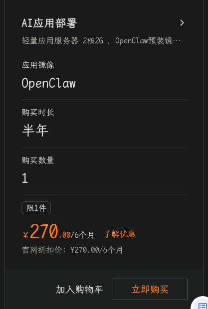
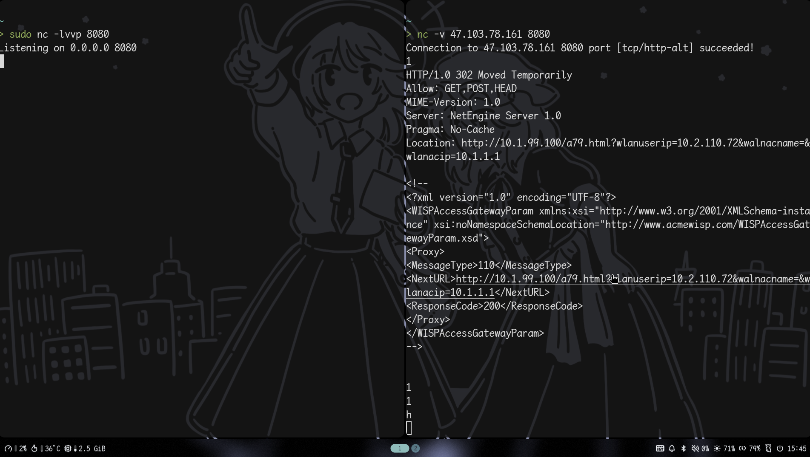

# 声(叠)明(甲)

本文/本帖涉及的相关技术原理与代码示例仅限教学、学术研究及安全防护能力提升之目的，旨在帮助读者理解底层运行机制与安全漏洞原理。
请勿将本文涉及的技术手段用于任何未授权的渗透测试、攻击或非合法合规商业行为。
读者因使用本文涉及的技术或代码所导致的任何直接或间接法律责任、安全事件及系统损失，作者概不承担任何连带或连带保证责任。
请严格遵守《网络安全法》及相关法律法规，共同维护清朗的网络空间。

# 前言

该教程是为了绕过校园网，而不是破解校园网，所以仍然需要一定的成本，但是相比购买校园电话卡的月费60,本方案可以做到年费30-60左右，成本很低

需要准备的工具，一台轻量级服务器

服务器要求：
1. 内存500MB以上，硬盘10GB(国内的云服务器厂商提供的最便宜的轻量级服务器基本都可以满足)
2. 公网ipv4，共享带宽（重点，一定要无固定流量的共享带宽）

服务器推荐：阿里云有学生优惠，只要完成大学生认证就可以每年获得300代金卷，可够买270一年的轻量服务器，如图所示

# 原理解析

据我由实验数据推测，校园网关的认证方式为主动探测开放端口的tcp流量，未未认证的流量会被重定向到登录页面，但是如果含有ssh特征则会直接放行，而udp协议则不会触发任何拦截

目前，我发现的开放端口有22,80,443,8080，其中22端口是个例外，该端口没有任何非认证重定向机制，所以可以拿来搭建基于tcp的代理协议

依据上述原理，共有两种方案

1. ssh隧道穿透
2. 基于udp的代理协议穿透

由于实际测试中，所有基于tcp的协议普遍质量较差，延迟极高，我判断为校园网关的拥塞管理与限速导致(有兴趣的可以自行抓包分析，这里不展开讨论)，所以本教程主要以基于udp协议搭建

# 教程

